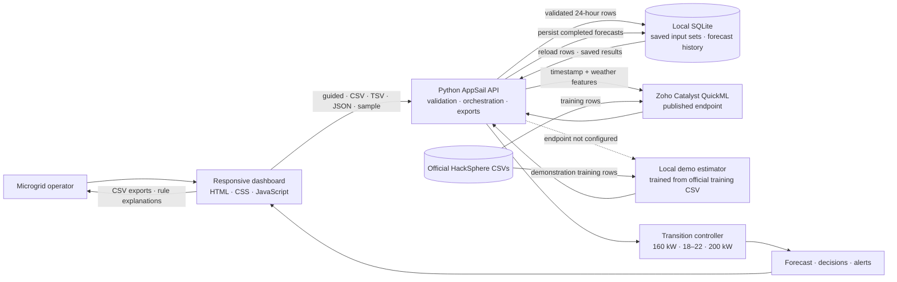

# GridSense AI architecture

The local estimator is a transparent demonstration fallback. QuickML is selected whenever its endpoint URL is configured; failures then return an error and do not silently switch to local predictions. The controller is server-side and has no connection to physical grid equipment.

## Request path

1. The UI loads the official sample, accepts CSV/TSV/JSON, or builds an editable 24-hour manual window with date and measurement hints.
2. The backend maps common header aliases, normalizes timestamps, and checks numeric values, validation bounds, unique timestamps, and consecutive hourly ordering.
3. The model adapter calls QuickML or, when the URL is absent, the local fallback trained from `train_telemetry.csv`.
4. The validated input set is saved locally before inference; a successful forecast and its summary are stored in the SQLite history.
5. The response is checked for finite values and a one-to-one match with the input rows.
6. The controller independently evaluates mode and overload rules for every prediction.
7. The UI renders the results, explanations, alerts, copilot context, and exports from the same forecast. Saved inputs/results can be loaded again after a local server restart.

## Custom energy data and model scope

The guided editor and imports accept new or fictional hourly energy scenarios when they contain the supported timestamp, ambient temperature, humidity, and solar irradiance fields. Every dashboard phase consumes the resulting same forecast object. Additional unrelated columns are ignored; a custom data set does not retrain the local demonstration model. Accurate site-specific forecasts require representative timestamped features and measured demand targets, a model trained for that site, and validation against held-out site data.

The SQLite file is a single-workspace persistence option, not a shared or durable multi-instance production database. A production deployment still needs managed storage, authentication and authorization, backup/retention, monitoring, capacity testing, and real integrations for weather, battery telemetry, and hardware control.
